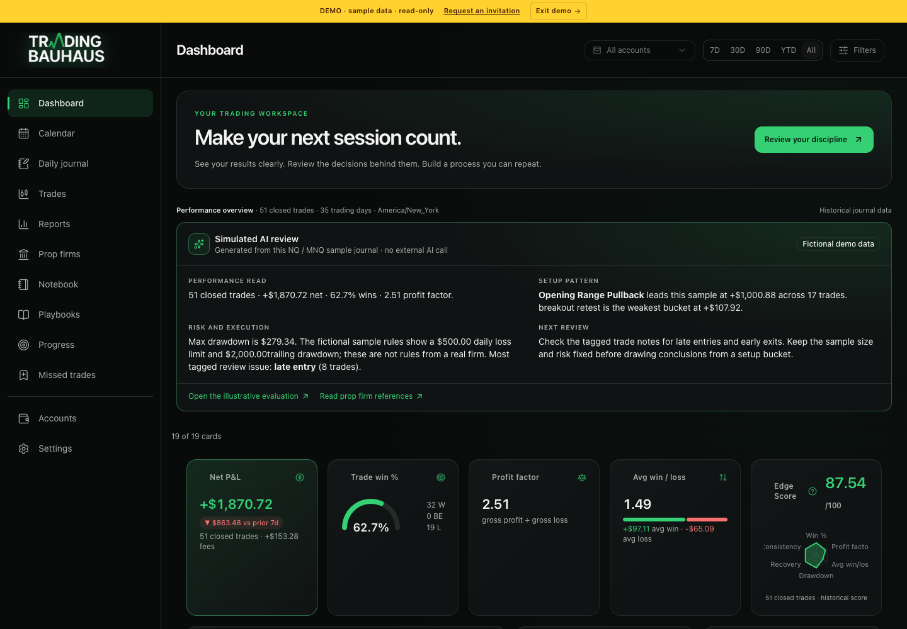
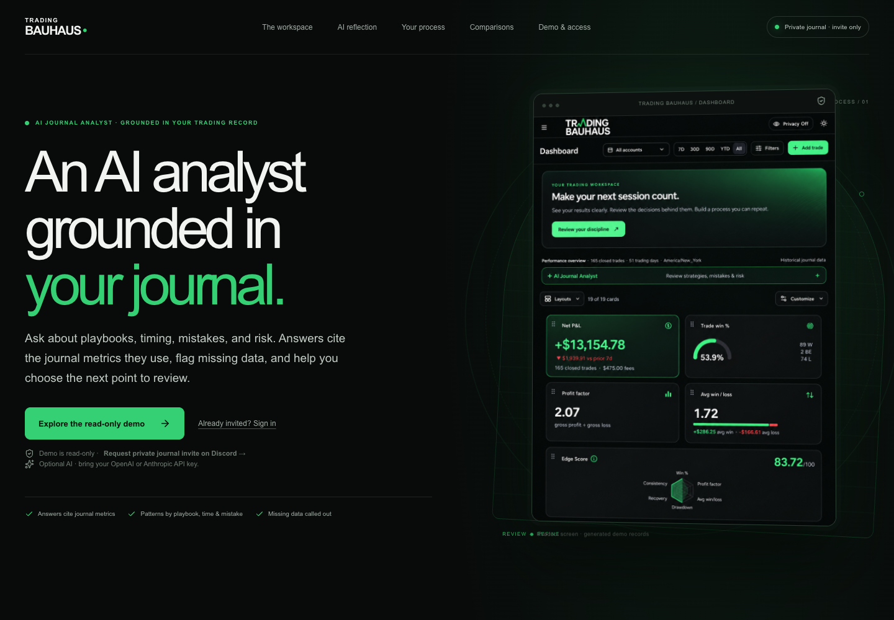
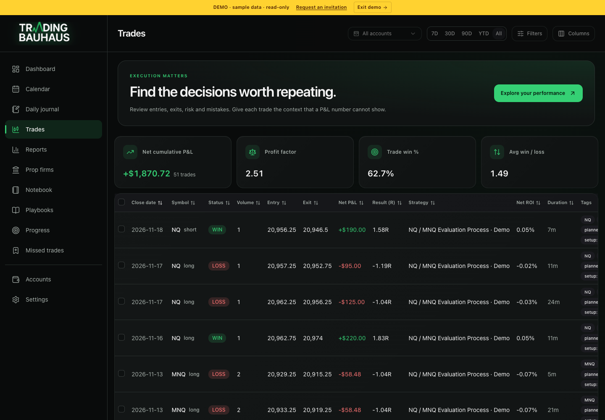
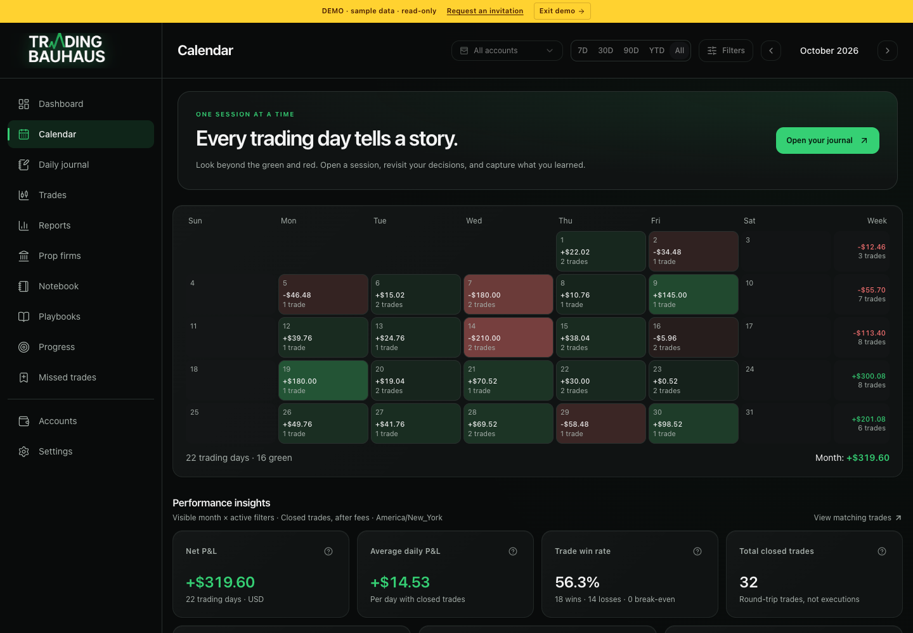
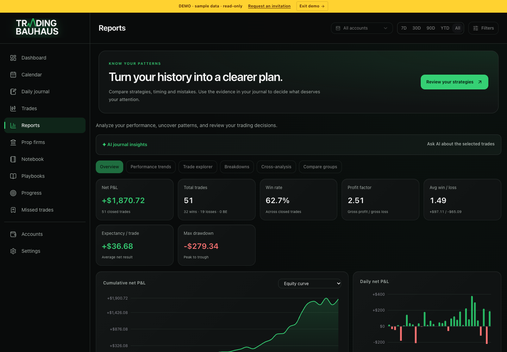
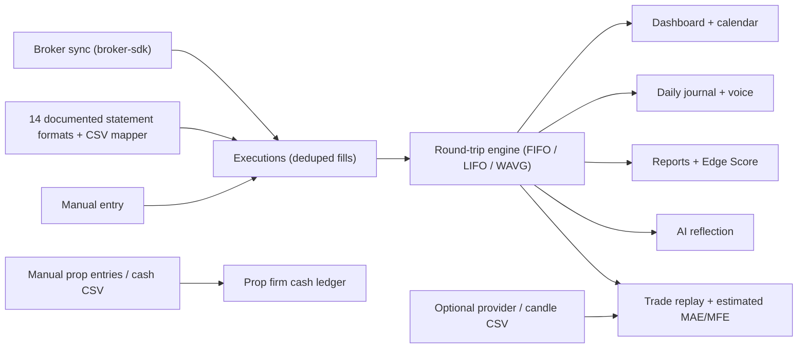

<div align="center">


<br/>

# Trading Bauhaus

**Your trades. Your process. Your own trading journal.**

A Bauhaus-inspired workspace for trade review, performance analytics, candle replay, and daily reflection. Self-host it locally or on your own server.

[](packages/core/src/types.ts)
[](#quickstart)

[Quickstart](#quickstart) · [Screenshots](#screenshots) · [Features](#features) · [How it works](#how-it-works) · [Licencia comercial · ES](docs/commercial-license.md)

</div>

---

**Record every trade. Review the decisions behind it.** Connect a broker, drop in a statement export, or add trades manually from the dashboard. Trading Bauhaus rebuilds your history into round-trip trades, a P&L calendar, analytics, and a daily journal you can type, dictate, or review with your own AI. Your journal lives in an isolated SQLite database; broker sync, market data, and AI connect to services you choose.

> ⚠️ **Early release.** APIs and schema may still move before 1.0. Parser validation varies by format, from synthetic fixtures to cross-checked field sources; per-format status lives in [docs/importers.md](docs/importers.md).

## Screenshots



A dark, geometric interface built around the trading review workflow. All figures
shown here are synthetic demo data, not trading results or performance claims.

- **Keep your journal on your server.** SQLite storage, isolated member journals,
  and a read-only public demo.
- **Review the whole trade.** Imports and broker sync, execution history,
  performance reports, and a P&L calendar.
- **Replay and reflect.** Candle replay with configured market data, structured
  notes, voice dictation, and optional AI reflection using your chosen provider.

<details>
<summary>Explore all five screens</summary>

### Welcome



### Dashboard


### Trades



### Calendar



### Reports



</details>

See [capture provenance and regeneration instructions](docs/imagenes-proyecto/README.md).
This is an early commercial project; [licensing terms](#license) and seller details
are still being finalized.

## Quickstart

Run these commands from the Trading Bauhaus project directory. The public demo is read-only; private workspaces require an owner or an owner-issued invitation.

```bash
pnpm install --frozen-lockfile
pnpm dev
# http://localhost:3000
```

Requirements: **Node 22+** and **pnpm 11.25.0** (the version pinned in `package.json`). First run creates the SQLite database and applies additive schema upgrades automatically. With the commands above, local data lives in `apps/web/data/`.

For smooth everyday use or UI reviews, stop the development server and run `pnpm preview`.
This builds the app once, then serves the optimized production version at the same address,
using the same local data. Unlike `pnpm dev`, it does not compile each page on its first
visit or hot-reload code edits. After code changes, stop it and rerun `pnpm preview` to
rebuild; use `pnpm start` to reuse an existing build. Switch back to `pnpm dev` when editing.
Run only one mode at a time, since development and production share the build directory.

### Try it with demo data

On an empty dashboard, choose **Load demo data** to create a separate demo account with about 90 days of generated trades. You can remove that account later in **Accounts**.

To try statement import, use [`docs/samples/demo-trades-tradingview.csv`](docs/samples/demo-trades-tradingview.csv) in **Import → File upload**. It contains synthetic TradingView paper-trading fills across 13 symbols, from March 2025 through September 2026. Review the detected format, timezone, warnings, and preview before importing.

The **Prop firms** page has its own **Load demo data** button: a read-only simulation of fictional firms, evaluation costs, and payouts. That preview stays in browser memory and does not write financial records.

### Preview with exactly 20 trades

With the local server running, execute `pnpm demo:20` (requires Python 3). This creates the separate **Demo — 20 trades** account: 18 closed trades and 2 open positions, with synthetic entries, partial exits, fees, stops, targets, strategy labels, mistake tags, and review notes. The script prints the account URL and verifies the count. Re-running it reuses the same examples and reapplies their demo annotations; avoid editing that account if you intend to rerun the generator. It never deletes existing accounts. These are fictitious prices, not historical market data.

### Docker

```bash
docker compose up -d
# http://localhost:3000, owner/member/demo databases persist under ./data on the host
```

### Public demo and invite-only access

The public **Example profile** opens a seeded, read-only journal with fictional records. Its database is isolated at `JOURNAL_DATA_DIR/public-demo/journal.db`; it persists across app restarts and never uses owner or member journals. Production requires a strong `JOURNAL_PASSWORD` for the owner; multi-user mode is on by default there. The owner can create seven-day, one-use invitation links from **Invitations** in the private sidebar and share them directly; the app does not send invitation email.

Owner records stay in `JOURNAL_DATA_DIR/journal.db`. Each invited member gets a separate database under `JOURNAL_DATA_DIR/users/<user-id>/journal.db`, so journal entries, trades, accounts, notes, and settings are private to that member. The root page and `/demo` remain public; workspace pages and data APIs require an owner or invited-member session. Set `JOURNAL_MULTI_USER=false` explicitly only for the legacy single-owner setup.

### Configuration

| Env var              | Effect                                                                                                   |
| -------------------- | -------------------------------------------------------------------------------------------------------- |
| `JOURNAL_PASSWORD`   | Owner password; required in production                                                                   |
| `JOURNAL_MULTI_USER` | Set to `true` for owner-issued invitations and separate member databases; defaults on in production      |
| `JOURNAL_SECRET`     | Encryption key source for credentials at rest (default: generated key file in the data dir)              |
| `JOURNAL_DATA_DIR`   | Database, attachments, and local encryption key directory (default `./data` relative to the app process) |
| `ANTHROPIC_API_KEY`  | Owner-only Anthropic AI key in invite-only mode; otherwise uses the configured environment key           |
| `OPENAI_API_KEY`     | Owner-only OpenAI AI key in invite-only mode; otherwise uses the configured environment key              |

Set these in the process environment or in `apps/web/.env.local` for local Next.js runs; the root [`.env.example`](.env.example) documents the values. In local development, set `JOURNAL_MULTI_USER=true` to preview invited-member access. For Docker, configure the service environment in [`docker-compose.yml`](docker-compose.yml).

For AI, open **Settings → AI**, select **Anthropic** or **OpenAI**, enter your API key, and choose **Save AI settings**. OpenAI defaults to `gpt-4.1-mini`; you can enter another text model ID available to your account. Each provider keeps its own encrypted key and model choice. Existing Anthropic settings continue to work. In invite-only multi-user mode, environment keys are restricted to the owner; each member must save a personal key in their own journal and cannot consume the owner's API allowance. An OpenAI-only owner environment setup selects OpenAI automatically; with both keys present, Anthropic remains the default until the owner saves a provider choice. Environment keys override the owner's saved keys and must be changed on the server. Saving settings does not make a model request or verify account access.

Deploy anywhere a Node process and a persistent disk exist: Docker, Railway, Fly.io, a small VPS. Serverless platforms without a disk need an external database, which this release does not support. SQLite on disk is the point.

Optional historical market data powers estimated MAE/MFE and candle replay on closed trades. Configure a connection or upload candle CSVs in **Settings → Market data**. No provider is enabled or selected by default. See [Market data and replay](#market-data-and-replay) below and the [market data guide](docs/market-data.md) for setup, calculation definitions, and coverage limits.

The **Prop firms** sidebar tracks evaluation/reset costs, refunds, payout requests, and actual receipts across your own firms and accounts. It includes cash ROI, partial payouts, reversals, renewal reminders, attachments, and generic CSV import/export. In invite-only multi-user mode, server environment credentials for market data and AI are restricted to the owner; each member configures personal credentials in their journal. See [Prop firm tracking](#prop-firm-tracking) below and the [prop firm guide and research](docs/prop-firms.md) for workflows and metric definitions.

### Add a trade manually

Choose **Add trade** on the dashboard to open the entry form. Select or create a manual account, enter the symbol, and add your buy and sell executions with their date, time, quantity, price, and optional fee. Save an entry alone for an open position, or include the exit for a closed trade. Use **Add execution** for partial fills or additional legs. Dates and times use your device's timezone.

The optional **Notes** field supports Markdown and saves with the trade. When adding fills to an existing position, new notes append to its existing notes. After saving, the dashboard refreshes automatically. The same form is available under **Import → Manual**.

### Combine accounts in a reporting currency

Choose each account's currency from the dropdown when creating it. The dashboard and calendar use that currency for native amounts. To combine accounts with different currencies, open **Settings → Currency conversion**, choose a reporting currency, enter your own baseline rates, and enable conversion. Each rate means **1 unit of the account currency = the entered amount in the reporting currency**; the reporting currency itself always has a rate of 1.

Conversion works entirely offline and uses no rate service or API key. Saved rates apply consistently to P&L, fees, starting balances, charts, drawdown and other monetary metrics. These are fixed-rate trading-performance figures, not live FX valuations or broker conversion amounts. Updating rates recalculates displayed history; original records remain unchanged, and trade details and reports continue using their original account data. Until all required rates are saved, mixed-currency dashboard and calendar selections show separate currency totals rather than a combined amount.

## Why this exists

A trading journal is a **verified record** of what you actually did and a place to reflect on that record. Trading Bauhaus keeps the journal in its configured data directory and lets you connect the AI provider you choose.

- **You control your connections.** Broker, market-data, and saved AI credentials are encrypted at rest with AES-256-GCM. Your server uses them to contact the provider you configure.
- **Your numbers are auditable.** The [Edge Score](docs/edge-score.md) is a documented, versioned formula, not a proprietary black box. Metric formulas are documented and covered by unit tests.
- **Your journal is portable.** Export trades as CSV, journal records as JSON, and reviews as PDF or PNG. Create an encrypted installation snapshot to retain every owner/member/demo journal, encryption key file, and attachment; see [Export and backup](#export-and-backup).

## How it works

One primitive drives everything: a raw **execution** (a fill). Executions come in from broker sync, statement imports, or manual entry; the round-trip engine turns them into trades; every surface reads from there.



## Features

|                          |                                                                                                                                                                                                                                                                                                                                                                                                                                                                                                                                                            |
| ------------------------ | ---------------------------------------------------------------------------------------------------------------------------------------------------------------------------------------------------------------------------------------------------------------------------------------------------------------------------------------------------------------------------------------------------------------------------------------------------------------------------------------------------------------------------------------------------------- |
| **Broker sync**          | Read-only sync for Alpaca, Binance, Bybit, Coinbase, Kraken, OKX, Tradier, IBKR Flex, Hyperliquid, Questrade, Topstep, Trading212, Webull, Crypto.com, E*TRADE, Public, Charles Schwab, TradeStation, tastytrade, Robinhood Crypto, Gemini, and KuCoin. Connect forms adapt to each supported provider.                                                                                                                                                                                                                                                    |
| **Statement import**     | **14 documented formats**, auto-detected: **TradeZella** and **Tradervue** (CSV migration), TradingView (paper and strategy exports), MetaTrader 4 and 5, ThinkorSwim, IBKR (activity + Flex), NinjaTrader, Tradovate, TopstepX, Webull, DAS Trader, plus a column mapper for any other CSV. Matching execution records dedupe within an account; review warnings and skipped rows before committing an import. Have an export we don't recognize? Open an issue with an anonymized sample; real files are the most useful contribution this repo can get. |
| **Round-trip engine**    | Flat-to-flat position cycles from raw fills. FIFO / LIFO / weighted-average per account. Partial fills, scale-ins, flips, futures multipliers. Annotations survive rebuilds.                                                                                                                                                                                                                                                                                                                                                                               |
| **Analytics**            | Net/gross P&L, win and day-win rates, profit factor, expectancy, R multiples, streaks, drawdown and recovery, profit concentration, duration/time-of-day/weekday performance, per-symbol/tag/mistake/playbook breakdowns. Advanced filters on every dimension, comparison groups, and a two-way cross-analysis matrix. Reports also include rolling performance trends and a trade explorer scatter plot, with saved MAE/MFE estimates where available.                                                                                                    |
| **Dashboard**            | P&L calendar with weekly totals, cumulative and daily P&L, gauges, the open **Edge Score v2** radar, open positions, time-of-day performance. Drag cards to rearrange, hide what you don't use, save named layouts. Calendar insights highlight daily patterns. Light/dark themes, a collapsible sidebar, and mobile navigation support smaller screens.                                                                                                                                                                                                   |
| **Trade pages**          | Entry/exit markers and P&L labels for recorded executions, optional user-selected market candles, and trade replay. Estimated MAE/MFE, running P&L, executions, ratings, stops/targets, tags, and mistakes.                                                                                                                                                                                                                                                                                                                                                |
| **Daily journal**        | Day stats, intraday P&L curve, autosaving Markdown notes with templates and attachments (images, PDFs). Type them or **dictate** them with browser speech recognition (no journal API key required; browser support and speech processing vary).                                                                                                                                                                                                                                                                                                           |
| **Notebook & playbooks** | Folders, search, tags, trade links; named setups with rule checklists scored per trade, with adherence and followed-vs-broken performance in Reports.                                                                                                                                                                                                                                                                                                                                                                                                      |
| **AI reflection**        | Bring your own Anthropic or OpenAI API key: session recaps, per-trade critiques, "ask your journal" over your own aggregates. Key encrypted at rest; requests go from your server to the model, nowhere else.                                                                                                                                                                                                                                                                                                                                              |
| **Routines & misses**    | Pre-, during- and post-session routines with weekday schedules and a 13-week history; a missed-opportunity log kept out of your trading metrics.                                                                                                                                                                                                                                                                                                                                                                                                           |
| **Journal defaults**     | Configure breakeven tolerance, plus fee and stop/target rules per account and symbol; set timezone and contract multipliers for consistent calculations.                                                                                                                                                                                                                                                                                                                                                                                                   |
| **Prop firms**           | Evaluation and reset expenses, refunds, payout requests, partial receipts, reversals, cash ROI, account phases, renewal reminders, attachments, and generic cash CSV import/export. Separate from trade P&L.                                                                                                                                                                                                                                                                                                                                               |
| **Privacy & export**     | Privacy mode masks every monetary value (charts keep their shape) and persists across tabs. Trades export to CSV, reviews to PDF or PNG, and journal records to JSON; credentials, candle datasets, and attachment binaries are excluded from that export.                                                                                                                                                                                                                                                                                                 |

IBKR broker sync uses **Settings → General → Default import timezone** for Flex
timestamps without an offset. Existing synced accounts with unknown or different
timezone provenance require recovery into a separate account; see
[IBKR timezone recovery](docs/importers.md#ibkr-broker-sync-and-timezone-recovery).

## Market data and replay

Trade pages initially show recorded fills. Opening a trade or Reports does **not** automatically request market history.

Choose an optional connection in **Settings → Market data**: **London Strategic Edge, Alpaca, OANDA, Binance, Coinbase**, or **Market data CSV**. Provider access, instruments, feeds, and quotas depend on your account; the journal ships no credentials or provider history. Candle uploads use their own OHLCV format, separate from trade statement imports.

On a closed trade, choose the source, exact symbol, and resolution, then select **Load market data**. Replay offers restart, play/pause, stepping, speed, and scrubbing. Confirm the instrument, price basis, and currency before calculating monetary excursions; derivatives also need a contract multiplier.

**MAE/MFE are estimates from observed candles and executions**, not tick-perfect values. They include scaling and partial exits, exclude fees and currency conversion, and remain unavailable when coverage or required inputs are missing. Option-contract history and reversing fills spanning multiple position cycles are currently unsupported. Saved valid estimates can be explored in **Reports → Trade explorer**; batch calculation is an explicit action and can be stopped. Recorded fills and realized P&L remain unchanged.

See the [market data guide](docs/market-data.md) for provider configuration, CSV schema, replay behavior, and calculation limits.

## Prop firm tracking

Track evaluation, verification, funded, instant-funded, and live accounts across your own firms. Keep resets and phase changes as linked records, with expenses, refunds, supporting attachments, and an audit history.

Payout requests and approvals are separate from actual receipts. Partial payments and reversals flow into cash totals on their receipt dates; **cash ROI uses money received and costs paid**, not nominal account size or trading P&L. Currency totals stay separate. Renewal reminders appear in the tracker; they do not charge money or send background notifications.

Use the documented generic CSV template to preview and import expenses, refunds, and money already received. Export filtered cash movements to CSV or the full tracker records with the journal's JSON export. This is a local tracker, with no automatic bank or prop firm sync and no payout-eligibility engine. See the [prop firm guide](docs/prop-firms.md) for workflows, formulas, and import rules.

## Migrating from TradeZella or Tradervue

Export a supported CSV and open **Import → File upload**. Choose the destination account and timezone, inspect the detected format and preview, then import. Unknown headers go to a column mapper; review warnings, errors, and skipped rows before saving.

**Settings → General** has separate **Display timezone** and **Default import timezone** fields. Use the broker statement's zone for imports and your preferred zone for trade times, analytics and journal days. Each file can override its statement timezone; the preview shows converted execution times before saving. Existing timestamps are unchanged by settings edits. See [timezone setup and correcting earlier imports](docs/importers.md#statement-and-display-timezones).

- **TradeZella:** trade-level rows become one entry and one exit at the reported average prices. Where the reconciliation check permits it, the difference between price-implied P&L and stated net P&L is folded into fees to preserve the stated result to the cent. Large discrepancies, including contract-multiplier cases, can skip that reconciliation; compare totals with your source export.
- **Tradervue:** the supported generic fill CSV imports executions directly, including the documented fee fields. It does not need trade-level reconstruction.
- **Reconstruction limits:** an average-price trade export cannot recover original partial fills or the intratrade price path. MetaTrader 5 deal reports and TradingView strategy exports have their own source and validation rules. The currently documented MT5 formats are HTML/CSV, not XLSX.

See [supported formats and validation status](docs/importers.md). Have an export we do not recognize? An anonymized sample and its export settings help us validate support.

## Export and backup

**Settings → Data & backups → Full backup (JSON)** exports the currently signed-in journal (owner or member): accounts (without credentials), executions, trades and annotations, daily journal entries, notebook folders and notes, templates, playbooks and rule checks, routines, missed trades, journal defaults, prop firm records and their audit history, and attachment metadata. It does not combine other members' journals or the public demo database. Trades also export as CSV; review exports support PDF and PNG.

JSON export excludes credentials, candle datasets, saved market-data estimates, and attachment binaries. It remains an account-level export. For a full installation snapshot, stop the app and run `pnpm backup -- --confirm-app-stopped <new-backup-file>` with a unique `JOURNAL_BACKUP_PASSPHRASE` of at least 20 characters supplied from a secret manager. The encrypted archive includes SQLite online snapshots for owner, every member and the public demo, plus other regular files in `JOURNAL_DATA_DIR` (including `.secret` and attachment BLOBs). Put the archive in a restricted off-host location; the command does not upload or schedule it. Preserve `JOURNAL_SECRET`, the owner password, proxy token and public origin in a separate secret manager.

Restore with `pnpm restore -- <encrypted-backup-file> <new-data-directory>`. It refuses to overwrite an existing directory, validates the encrypted stream, and runs SQLite `quick_check` on every restored database. The new directory is not activated automatically; validate it, configure the original external secrets and plan a stopped cutover. Plaintext snapshot files are created temporarily in `JOURNAL_DATA_DIR` with restrictive permissions and removed on completion; run on encrypted storage because ordinary file deletion is not secure erasure. Keep original candle CSVs separately if they are not in SQLite.

Default locations: `apps/web/data/` for the pnpm commands above, or the host's `./data` bind mount for `docker-compose.yml`. The preview Compose file uses the named `journal_data` volume; it survives container recreation, but `docker compose down -v` deletes it. Back up that entire volume separately before removing it. `JOURNAL_DATA_DIR` overrides the app's path.

## Architecture and improvement priorities

See [architecture and trader workflow priorities (Spanish)](docs/architecture.md) for module boundaries and trading workflow improvements, and the [launch roadmap](docs/launch-roadmap.md) for support, billing readiness, backups, deployment, and launch validation. The Trades table includes net result in R and strategy names; planned risk and mistake tags are available through Columns.

## Project structure

| Package                                    | What it is                                                                                                   |
| ------------------------------------------ | ------------------------------------------------------------------------------------------------------------ |
| [`packages/core`](packages/core)           | `@trading-bauhaus/journal-core`: internal trading calculations and analytics. No IO or framework dependency. |
| [`packages/importers`](packages/importers) | `@trading-bauhaus/journal-importers`: internal statement parsers and migration importers.                    |
| [`apps/web`](apps/web)                     | The app: Next.js 15, SQLite (Drizzle), Tailwind, Recharts/ECharts, charting, TanStack Table, and AI SDK.     |

### Internal domain packages

The core and importer packages are private parts of this workspace and are not published to npm. The app imports them directly through workspace names:

```ts
import { buildRoundTrips, computeMetrics, computeEdgeScore } from "@trading-bauhaus/journal-core";
import { parseAuto } from "@trading-bauhaus/journal-importers";

const parsed = parseAuto(csvText, { timeZone: "America/New_York" });
if (!parsed) throw new Error("Unrecognized format: offer a column mapping.");
if (parsed.errors?.length) throw new Error(parsed.errors.join("\n"));
if (parsed.needsSymbol) throw new Error("Supply the missing symbol and parse again.");
// Review parsed.warnings and parsed.skippedRows before saving.
const executions = parsed.executions.map((fill) => ({
  ...fill,
  id: crypto.randomUUID(),
  accountId: "my-account",
  source: "import" as const,
}));
const trades = buildRoundTrips(executions, { method: "fifo" });
const metrics = computeMetrics(trades, { timeZone: "America/New_York" });
const edge = computeEdgeScore(metrics);
```

```bash
pnpm test          # tests for the core, importers, and app logic
pnpm typecheck     # all packages
pnpm format:check  # prettier
pnpm build         # production build
```

## Principles

No external journal analytics or tracking service. The self-hosted journal stands alone. Sanctioned APIs only.

External requests serve the features you choose: broker sync, market history, and Anthropic- or OpenAI-powered reflection. Browser dictation may use the browser vendor's speech service ([browser speech recognition behavior](https://developer.mozilla.org/en-US/docs/Web/API/SpeechRecognition)). Next.js has its own [framework telemetry setting](https://nextjs.org/telemetry); set `NEXT_TELEMETRY_DISABLED=1` to disable it when running or building the app.

## Disclaimer

Trading Bauhaus reports and analyzes what your broker reports. Nothing it computes or generates (including AI recaps, critiques, and answers) is investment advice, and no metric predicts future results. Verify important numbers against your broker's own statements.

## License

Trading Bauhaus is a private commercial product. Original contributions require
purchase of a commercial license through a written agreement with the authorized
rightsholder; see [LICENSE](LICENSE) and the [purchase and licensing guide (Spanish)](docs/commercial-license.md).
These are draft terms pending legal review and seller details. There is currently
no checkout, payment processor, license-key issuer, or runtime activation check.
The inherited LuxAlgo MIT notice is preserved in full, and existing MIT and
third-party permissions remain applicable. Workspace packages remain private and
marked `UNLICENSED` to prevent implying a public package license.
