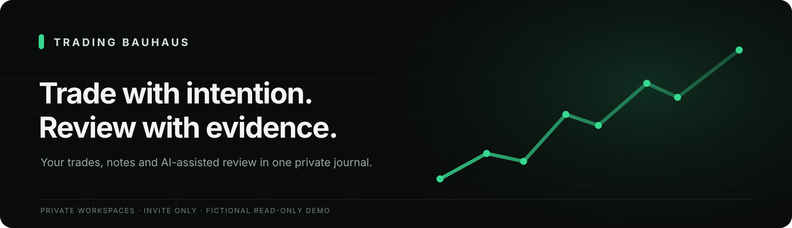
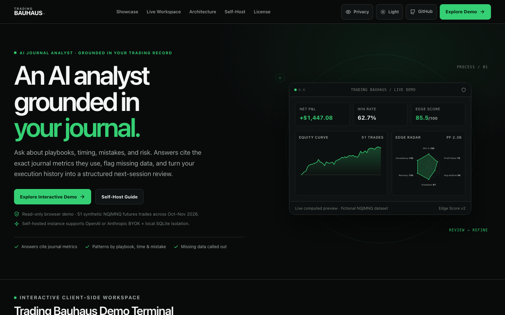
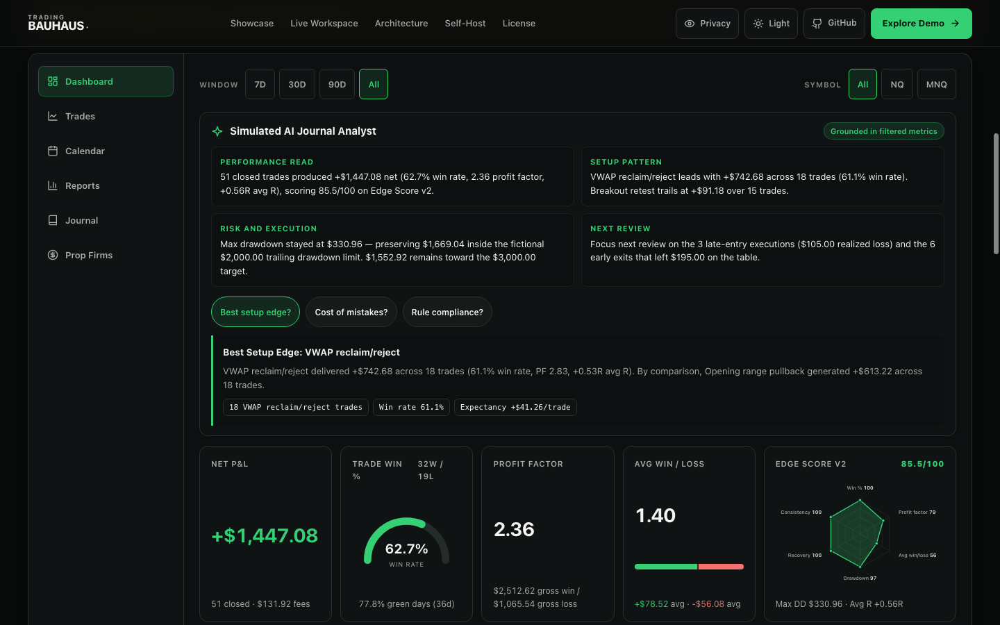
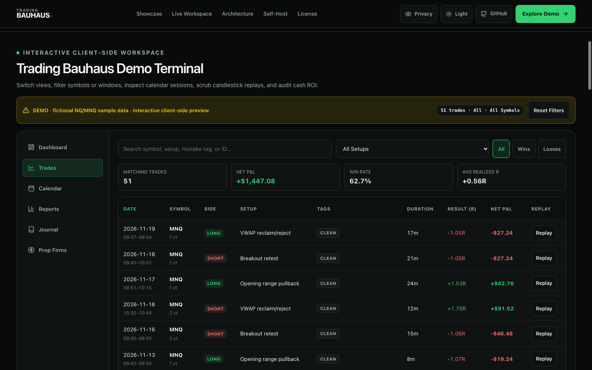
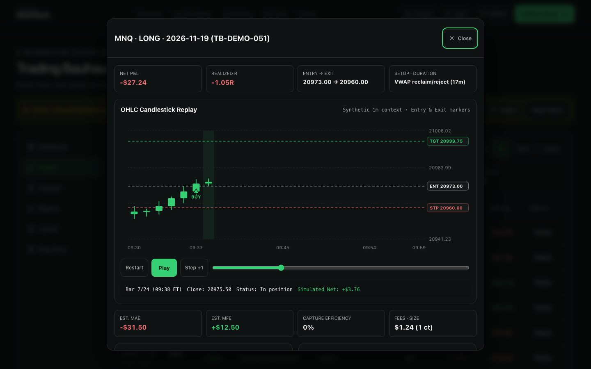
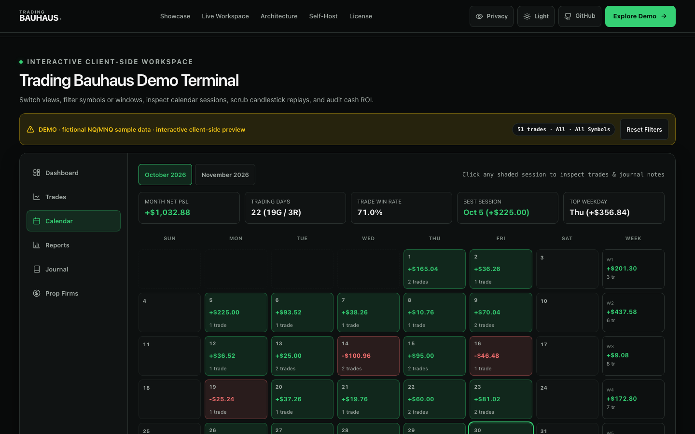
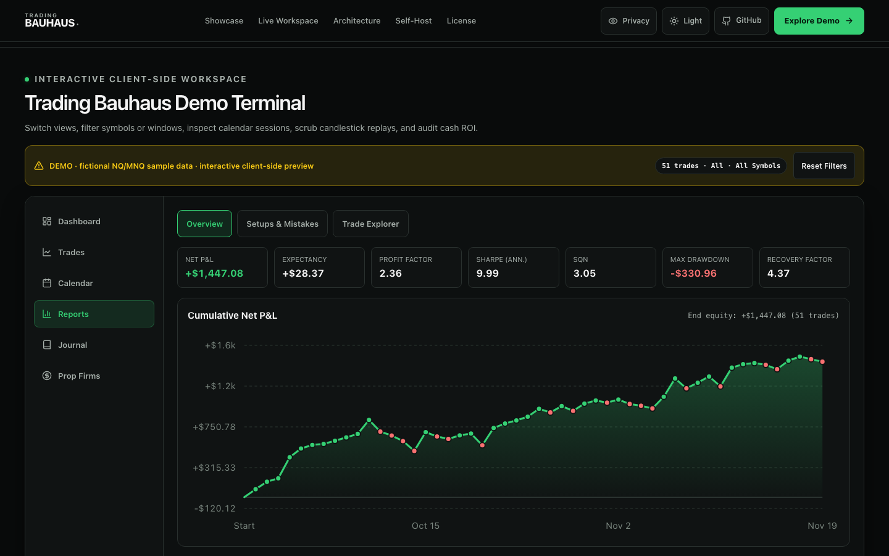
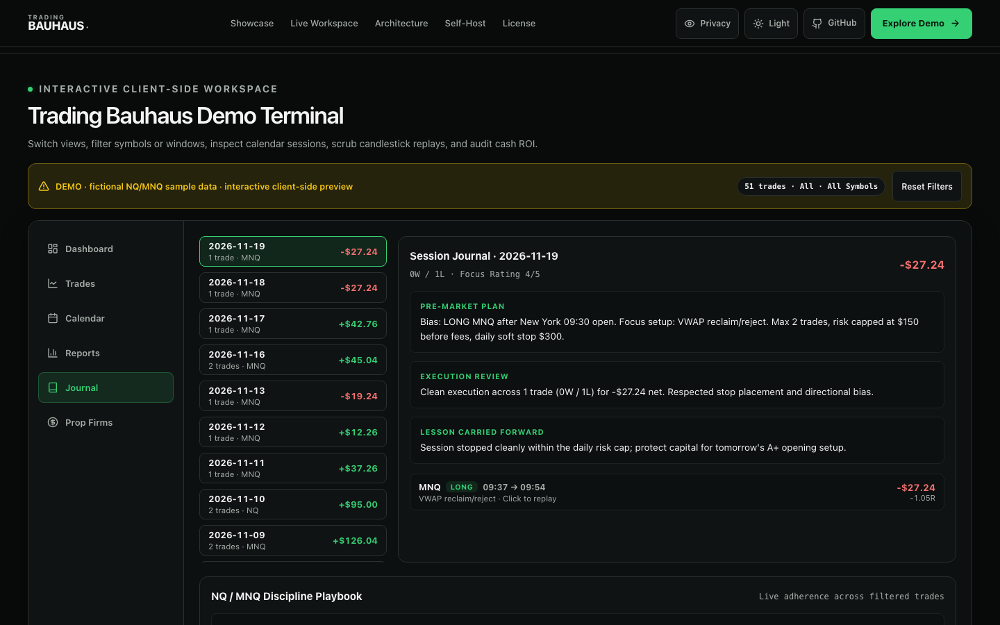
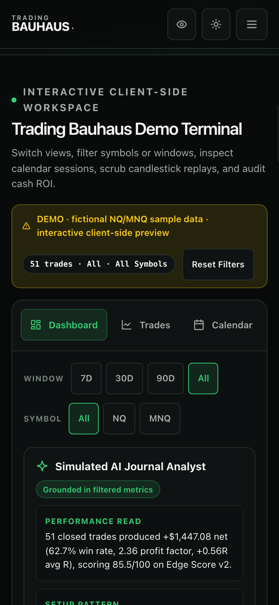
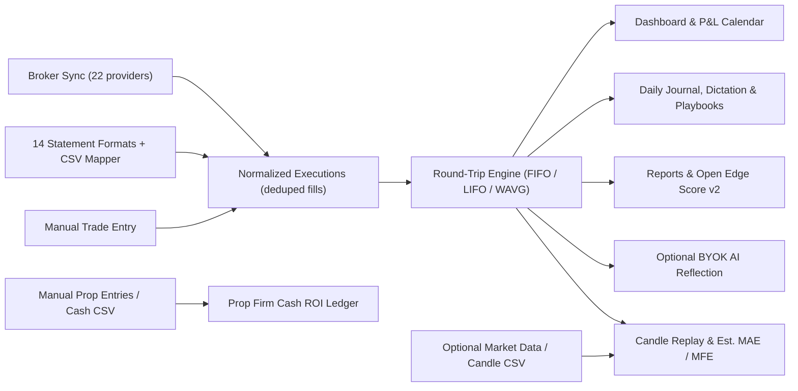

<div align="center">



<br/>

# Trading Bauhaus

**Your trades. Your process. Your own trading journal.**

A dark-first, Bauhaus-inspired trading journal for trade review, open **Edge Score v2** analytics, OHLC candle replay, daily reflection, and optional grounded AI analysis. Explore the interactive read-only showcase live on GitHub Pages or self-host the complete Next.js 15 + SQLite platform on your own machine or server.

[](packages/core/src/types.ts)
[](apps/web/package.json)
[](#self-hosted-quickstart--configuration)
[](https://github.com/annoris/AI-trading-bauhaus-journal/actions/workflows/ci.yml)
[](https://github.com/annoris/AI-trading-bauhaus-journal/actions/workflows/pages.yml)
[](LICENSE)

[**Live Interactive Demo (GitHub Pages)**](https://annoris.github.io/AI-trading-bauhaus-journal/) · [Visual Walkthrough](#visual-walkthrough) · [Core Capabilities](#core-capabilities) · [Self-Host Quickstart](#self-hosted-quickstart--configuration) · [Documentation](#documentation-index) · [Sponsor & License](#sponsor--contribute)

</div>

---

## Table of Contents

- [What is Trading Bauhaus?](#what-is-trading-bauhaus)
- [Visual Walkthrough](#visual-walkthrough)
- [Visual System, Typography & Accessibility](#visual-system-typography--accessibility)
- [How It Works & Core Capabilities](#how-it-works--core-capabilities)
- [Self-Hosted Quickstart & Configuration](#self-hosted-quickstart--configuration)
- [Technical Architecture & Project Structure](#technical-architecture--project-structure)
- [Running Locally, Validation & Screenshot Capture](#running-locally-validation--screenshot-capture)
- [GitHub Pages Deployment](#github-pages-deployment)
- [Documentation Index](#documentation-index)
- [Principles, Disclaimer & Commercial License](#principles-disclaimer--commercial-license)

---

## What is Trading Bauhaus?

**Trading Bauhaus** turns raw broker executions into an auditable review terminal. Whether you inspect the zero-dependency interactive browser showcase or run the full self-hosted Next.js 15 + SQLite application locally or in Docker, every figure traces back to documented formulas, signed numbers, zero-anchored charts, and isolated storage under your own control.

> **Early Release & Fictional Demo Notice:** APIs and SQLite schema may evolve before 1.0. Parser coverage varies by statement format (see [importer status](docs/importers.md)). Every figure shown in the live GitHub Pages showcase and screenshots comes from a deterministic, **fictional NQ / MNQ futures demo dataset** (51 closed trades across October–November 2026) and does not represent live brokerage returns or investment advice. Self-hosted or commercial use requires a verified contribution via Solana or a written commercial agreement ([licensing terms](#commercial-license)).

### Key Highlights

- **Live Client-Side Showcase (`site/`):** A zero-dependency, buildless HTML5 / CSS3 / vanilla ES-module workspace deployed to [**GitHub Pages**](https://annoris.github.io/AI-trading-bauhaus-journal/) featuring interactive timeframe/symbol filtering, Simulated AI Journal Analyst prompts, 6-axis Edge Score v2 radar, interactive `<dialog>` OHLC candle replay, monthly P&L calendar drilldowns, scatter explorer, daily journal playbooks, prop-firm cash ROI ledger, Privacy Mask (`$••••`), and Dark/Light theme switching.
- **Open, Auditable Math (`packages/core`):** FIFO / LIFO / weighted-average round-trip matching, R-multiple risk math, drawdown curves, Sharpe/Sortino/SQN ratios, and the pinned **Edge Score v2** formula (`Win %`, `Profit factor`, `Avg win/loss`, `Drawdown`, `Recovery`, `Consistency`).
- **14 Documented Statement Formats & Broker Sync (`packages/importers`):** Auto-detects TradeZella, Tradervue, TradingView, MetaTrader 4/5, ThinkorSwim, IBKR (Activity + Flex), NinjaTrader, Tradovate, TopstepX, Webull, DAS Trader, plus a custom CSV mapper and read-only broker sync adapters.
- **Isolated Per-Member SQLite & Encrypted Backups (`apps/web`):** Owner and invited-member journals live in separate SQLite databases under `JOURNAL_DATA_DIR`, with AES-256-GCM encryption at rest for saved credentials and encrypted `.tbjbackup` snapshot/restore commands.
- **Optional BYOK AI Reflection:** Connect Anthropic or OpenAI keys on your own server for grounded session recaps, trade critiques, and Q&A over filtered journal aggregates—never third-party journal telemetry.

---

## Visual Walkthrough

Every screenshot below was captured directly from the live rendered GitHub Pages showcase using headless Google Chrome (`1440×900` desktop and `390×844` `@2x` mobile) via `pnpm screenshots`.

### 1. Editorial Welcome Showcase (`#welcome`)



- **On Screen:** A `#090b0b` obsidian canvas frames the crisp `TRADING BAUHAUS •` navigation bar (`Showcase`, `Live Workspace`, `Architecture`, `Self-Host`, `License`, `Privacy`, `Light`, `GitHub`, and `Explore Demo`), paired with the editorial headline _"An AI analyst grounded in your journal."_
- **Highlights:** Subtle rotating orbital rings and corner coordinates (`PROCESS / 01`, `REVIEW → REFINE`) frame a live-computed terminal card rendering Net P&L (`+$1,447.08`), Win Rate (`62.7%`), Edge Score (`85.5/100`), a cumulative equity SVG curve, and a 6-axis Edge Radar directly from the synthetic NQ/MNQ dataset.
- **Interactions:** Clicking **Explore Interactive Demo** scrolls straight into the interactive client-side terminal; **Privacy** masks every monetary value to `$••••` while preserving percentages and chart shapes.

---

### 2. Interactive Dashboard & Simulated AI Analyst (`#view=dashboard`)



- **On Screen:** Inside the read-only yellow demo banner (`51 trades · All · All Symbols`), the workspace pairs a left sidebar (`Dashboard`, `Trades`, `Calendar`, `Reports`, `Journal`, `Prop Firms`) with Window (`7D`, `30D`, `90D`, `All`) and Symbol (`All`, `NQ`, `MNQ`) filter chips.
- **Highlights:** The **Simulated AI Journal Analyst** breaks down _Performance Read_, _Setup Pattern_, _Risk and Execution_ (showing `$2,000.00 trailing drawdown`), and _Next Review_, alongside interactive prompt chips (_Best setup edge?_, _Cost of mistakes?_, _Rule compliance?_) that dynamically cite exact filtered numbers. Below sit five executive KPI cards—including the semicircle **Trade Win %** gauge, dual **Avg Win / Loss** ratio bar, and unclipped 6-axis **Edge Score v2** radar—plus an interactive equity curve and recent executions list.
- **Interactions:** Toggling any timeframe or symbol chip recalculates every KPI, chart, AI briefing card, and cited prompt response in real time.

---

### 3. Trades Explorer (`#view=trades`)



- **On Screen:** Full-width search bar, setup filter (`All Setups`, `Opening range pullback`, `VWAP reclaim/reject`, `Breakout retest`), outcome filter (`All`, `Wins`, `Losses`), four live summary cards (`Matching Trades`, `Net P&L`, `Win Rate`, `Avg Realized R`), and a sortable execution ledger.
- **Highlights:** Every row preserves entry/exit ET timestamps, contract count, direction badge (`LONG` / `SHORT`), setup label, mistake tag badges (`late entry`, `early exit`, `slipped stop`, or `clean`), holding duration, signed realized R, signed net P&L, and a dedicated **Replay** trigger.
- **Interactions:** Click any column header (`Date`, `Symbol`, `Duration`, `Result (R)`, `Net P&L`) to toggle ascending/descending sort, or click **Replay** on any row to launch the candlestick replay modal.

---

### 4. Trade Detail & OHLC Candlestick Replay Modal (`<dialog id="trade-modal">`)



- **On Screen:** A native `<dialog>` overlay opens for the selected trade (`MNQ · LONG · 2026-11-19 (TB-DEMO-051)`), displaying Net P&L, Realized R, Entry → Exit price levels, Setup & Duration, and a synthetic 1-minute OHLC SVG candlestick chart.
- **Highlights:** Dashed reference lines and right-hand price pills (`TGT 20999.75`, `ENT 20973.00`, `STP 20960.00`) stay clear of Y-axis grid ticks, while directional `BUY`/`SELL` and `EXIT` markers appear as replay advances past the fill bar. Below the chart sit `Restart`, `Play / Pause`, `Step +1`, an interactive range scrubber, simulated bar-by-bar unrealized net P&L readout, Est. MAE/MFE, Capture Efficiency, playbook rule checklist, and structured review notes.
- **Interactions:** Step bar-by-bar, press `Play` for animated playback, scrub directly across all 24 bars, or dismiss cleanly with `Escape`, backdrop click, or `Close` (restoring focus to the triggering row).

---

### 5. Monthly P&L Calendar & Session Inspector (`#view=calendar`)



- **On Screen:** Month switcher (`October 2026` / `November 2026`), five monthly performance insight cards (`Month Net P&L +$1,032.88`, `Trading Days 22 (19G / 3R)`, `Trade Win Rate 71.0%`, `Best Session`, `Top Weekday`), and an 8-column `Sun–Sat + Week` calendar matrix.
- **Highlights:** Profitable and losing sessions combine soft emerald/crimson tints with explicit signed totals and trade counts, while the rightmost column totals each calendar week (`W1`–`W5`).
- **Interactions:** Clicking any shaded trading day selects that date and populates the **Session Inspector** directly below the calendar with that day's clickable trades (opening candle replay) and journal reflection.

---

### 6. Reports, Setup Breakdowns & Trade Scatter Explorer (`#view=reports`)



- **On Screen:** Three report sub-tabs (**Overview**, **Setups & Mistakes**, **Trade Explorer**) begin on Overview with seven statistical KPI cards (`Net P&L`, `Expectancy`, `Profit Factor`, `Sharpe (Ann.)`, `SQN`, `Max Drawdown`, `Recovery Factor`), a full-width Cumulative Net P&L area curve, and a zero-anchored Daily Net P&L bar chart.
- **Highlights:** **Setups & Mistakes** compares win rate, profit factor, average R, and net P&L per setup alongside quantified mistake impact cards; **Trade Explorer** plots Holding Duration vs. Net P&L (or Realized R) using distinct circle (win) and diamond (loss) markers.
- **Interactions:** Hover points on the equity curve or daily bars for exact trade/day readouts, switch Y-axis metrics on the scatter plot, or click any scatter marker to launch that trade's candlestick replay.

---

### 7. Daily Journal & Discipline Playbook (`#view=journal`)



- **On Screen:** A chronological session selector on the left pairs with structured journal notes (`Pre-Market Plan`, `Execution Review`, `Lesson Carried Forward`, focus rating, and clickable session trades) on the right, above the 6-rule **NQ / MNQ Discipline Playbook**.
- **Highlights:** Each playbook rule displays its live adherence percentage computed directly across the active filtered trade set. From the sidebar, **Prop Firms** opens the independent fictional cash-ROI ledger tracking evaluation expenses, fee refunds, partial payouts, and pending requests separately from trade P&L.
- **Interactions:** Select any trading session date to inspect its notes and launch replay on its executions, or filter Prop Firms ledger entries by `All`, `Expenses`, `Refunds`, and `Payouts`.

---

### 8. Responsive Mobile Terminal (`390×844 @2x`)



- **On Screen:** At narrow viewports (`390×844`), the sticky header preserves `TRADING BAUHAUS •`, `Privacy`, `Light`, and the drawer toggle (`#mobile-nav-btn`), while the workspace sidebar becomes a horizontal touch-scrollable tab strip above single-column filter controls, AI analyst blocks, and KPI cards.
- **Highlights:** Enforces `44px` minimum touch targets, `tabular-nums` alignment, and `minmax(0, 1fr)` grid sizing with verified zero horizontal overflow (`scrollWidth <= innerWidth`).
- **Interactions:** Opening the mobile drawer sets `main.inert = true`, moves focus to the close button, traps drawer escape behavior cleanly, and lets mobile users toggle Privacy Mask or Dark/Light themes from inside the drawer.

---

## Visual System, Typography & Accessibility

### Color Palette (`site/assets/css/tokens.css` & `apps/web/src/app/globals.css`)

| Token       | Dark Mode (Default) | Light Mode | Role Across Terminal & Showcase                            |
| :---------- | :------------------ | :--------- | :--------------------------------------------------------- |
| `--bg`      | `#090b0b`           | `#f9f9f7`  | Primary obsidian / warm-paper canvas                       |
| `--card`    | `#101313`           | `#fcfcfb`  | KPI cards, panels, tables, and sidebar surface             |
| `--popover` | `#151919`           | `#fcfcfb`  | Modal controls, chart reference badges, elevated surfaces  |
| `--border`  | `#29302e`           | `#e1e0d9`  | Crisp structural hairlines separating Bauhaus grid cards   |
| `--fg`      | `#f4f4f4`           | `#0b0b0b`  | Primary text and numeric KPI values                        |
| `--muted`   | `#a6afaa`           | `#52514e`  | Secondary metadata, axis labels, helper prose              |
| `--brand`   | `#35d074`           | `#15803d`  | Primary emerald accent, active filters, Edge Radar polygon |
| `--profit`  | `#35d074`           | `#006300`  | Positive fills, equity curve profit, winning markers       |
| `--loss`    | `#f87171`           | `#d03b3b`  | Negative P&L, drawdown readout, losing diamond markers     |
| `--warning` | `#facc15`           | `#a16207`  | Read-only demo banner and review mistake badges            |

### Typography & Accessibility Discipline

- **Geometric Sans & Monospace Stack:** Uses `Inter` / system sans (`-apple-system`, `BlinkMacSystemFont`, `"Segoe UI"`) paired with `JetBrains Mono` / system monospace for coordinates, prices, timestamps, and wallet hashes—with `font-variant-numeric: tabular-nums` on every financial readout.
- **Non-Load-Bearing Color:** Every monetary metric ships as signed text (`+$1,447.08` / `-$330.96`), bar charts anchor to zero, wins vs. losses in scatter plots use distinct geometric shapes (circles vs. rotated diamonds), and modal states use `EXIT` / `PASS` / `BREAK` text badges.
- **Accessible Controls:** Skip link (`#main-content`), `44px` minimum touch targets (`accessibility.css`), high-contrast `:focus-visible` outlines, `inert` background locking when the mobile drawer opens, `Escape` dismissal on dialogs, and `@media (prefers-reduced-motion: reduce)` animation dampening.

---

## How It Works & Core Capabilities

One core primitive drives the entire Trading Bauhaus engine: a normalized **execution** (fill). Executions enter from broker sync, 14 documented statement importers, or manual entry; the round-trip engine groups fills into trades; and every analytics surface, report, and AI reflection reads from those round trips.



### Feature Matrix

| Capability                    | Details                                                                                                                                                                                                                                                                             |
| :---------------------------- | :---------------------------------------------------------------------------------------------------------------------------------------------------------------------------------------------------------------------------------------------------------------------------------- |
| **Broker Sync**               | Read-only sync for Alpaca, Binance, Bybit, Coinbase, Kraken, OKX, Tradier, IBKR Flex, Hyperliquid, Questrade, Topstep, Trading212, Webull, Crypto.com, E\*TRADE, Public, Charles Schwab, TradeStation, tastytrade, Robinhood Crypto, Gemini, and KuCoin.                            |
| **Statement Import**          | **14 documented formats** auto-detected: **TradeZella**, **Tradervue**, TradingView (paper & strategy exports), MetaTrader 4/5, ThinkorSwim, IBKR (Activity + Flex), NinjaTrader, Tradovate, TopstepX, Webull, DAS Trader, plus a custom column mapper and execution deduplication. |
| **Round-Trip Engine**         | Flat-to-flat position cycles from raw fills using FIFO, LIFO, or weighted average per account—handling partial fills, scale-ins, flips, and futures multipliers while preserving annotations across rebuilds.                                                                       |
| **Analytics & Edge Score v2** | Net/gross P&L, win & day-win rates, profit factor, expectancy, realized R multiples, streaks, drawdown & recovery factor, profit concentration, Sharpe/Sortino/SQN, rolling performance trends, cross-analysis matrices, and the open 0–100 **Edge Score v2**.                      |
| **Trade Pages & Replay**      | Entry/exit markers, optional configured market-data candles (London Strategic Edge, Alpaca, OANDA, Binance, Coinbase, or OHLCV CSV upload), step/play/scrub replay, and estimated MAE/MFE.                                                                                          |
| **Daily Journal & Playbooks** | Intraday P&L curve, autosaving Markdown notes, file attachments, browser speech dictation, foldered notebooks, and per-trade rule adherence checklists.                                                                                                                             |
| **Optional AI Reflection**    | Bring your own **Anthropic** or **OpenAI** API key (`apps/web/.env.local` or encrypted settings). Requests run from your server to your selected provider over filtered journal aggregates—never third-party analytics.                                                             |
| **Prop Firm Cash Ledger**     | Tracks evaluation/reset costs, fee refunds, payout requests, partial payouts, reversals, renewal reminders, and true **Cash ROI** independently from trading P&L.                                                                                                                   |
| **Privacy & Backups**         | Instant Privacy Mask (`$••••`), CSV/PDF/PNG/JSON per-account exports, plus encrypted full-installation snapshots (`pnpm backup` / `pnpm restore` / `pnpm verify:backup`).                                                                                                           |

---

## Self-Hosted Quickstart & Configuration

### Local Development & Production Preview

Requirements: **Node.js 22+** and **pnpm 11.25.0** (pinned in [`package.json`](package.json)). First launch creates local SQLite databases automatically under `apps/web/data/`.

```bash
pnpm install --frozen-lockfile
pnpm dev
# App runs at http://localhost:3000
```

For smooth everyday use without per-route compilation, stop the dev server and run the production preview build:

```bash
pnpm preview
# Builds and serves optimized app on http://localhost:3000
```

### Demo Data & Sample Imports

- On an empty private dashboard, choose **Load demo data** to populate a separate synthetic demo account (~90 days of generated trades) that can be removed later in **Accounts**.
- Test file import using [`docs/samples/demo-trades-tradingview.csv`](docs/samples/demo-trades-tradingview.csv) under **Import → File upload** (13 symbols, March 2025 – September 2026).
- With the local server running, execute `pnpm demo:20` (requires Python 3) to seed **Demo — 20 trades** (18 closed trades + 2 open positions with annotations).

### Docker Compose

```bash
docker compose up -d
# http://localhost:3000 — owner, member, and demo SQLite DBs persist under ./data
```

See [`deploy/compose.preview.yml`](deploy/compose.preview.yml) and [`deploy/Caddyfile.example`](deploy/Caddyfile.example) for reverse-proxy preview templates.

### Environment Variables (`.env.example`)

| Env Var              | Effect                                                                                                                                                             |
| :------------------- | :----------------------------------------------------------------------------------------------------------------------------------------------------------------- |
| `JOURNAL_PASSWORD`   | Owner password; required in production self-hosted deployments.                                                                                                    |
| `JOURNAL_MULTI_USER` | Set to `true` for 7-day, one-use invitation links and separate member SQLite databases (`JOURNAL_DATA_DIR/users/<user-id>/journal.db`); defaults on in production. |
| `JOURNAL_SECRET`     | Encryption key source for stored broker, market-data, and AI credentials at rest (`AES-256-GCM`).                                                                  |
| `JOURNAL_DATA_DIR`   | Directory for SQLite databases, attachments, and local `.secret` key file (defaults to `./data` relative to app process).                                          |
| `ANTHROPIC_API_KEY`  | Owner-only Anthropic API key in multi-user mode (members save personal keys in their own journal).                                                                 |
| `OPENAI_API_KEY`     | Owner-only OpenAI API key in multi-user mode (`gpt-4.1-mini` default or custom model ID).                                                                          |

### Encrypted Backup & Restore

Export individual accounts as JSON/CSV/PDF/PNG from **Settings → Data & backups**, or snapshot the entire installation (owner, all members, public demo, `.secret`, and attachments) while the app is stopped using a 20+ character `JOURNAL_BACKUP_PASSPHRASE`:

```bash
pnpm backup -- --confirm-app-stopped /path/to/snapshot.tbjbackup
pnpm restore -- /path/to/snapshot.tbjbackup /path/to/new-data-dir
pnpm verify:backup
```

---

## Technical Architecture & Project Structure

```text
AI-trading-bauhaus-journal/
├── site/                                 # Zero-dependency GitHub Pages interactive showcase
│   ├── .nojekyll                         # Serves static files directly on GitHub Pages
│   ├── index.html                        # Semantic HTML5 showcase, 6-view terminal & <dialog> replay
│   └── assets/
│       ├── css/{tokens,styles,workspace,accessibility}.css
│       ├── images/favicon.svg
│       └── js/{demo-data,charts,app}.js  # Deterministic dataset, custom SVGs & interactive controller
├── apps/web/                             # Self-hosted Next.js 15 + Drizzle + SQLite full application
│   ├── src/app/                          # App Router pages & guarded API routes
│   ├── src/components/                   # UI primitives, ECharts/Recharts wrappers, Solana gate
│   ├── src/db/                           # SQLite schema & isolated DB bootstrapper
│   └── src/server/                       # Auth, invitations, importers, AI, Solana verifier, demo seed
├── packages/
│   ├── core/                             # @trading-bauhaus/journal-core (pure calculations & Edge Score v2)
│   └── importers/                        # @trading-bauhaus/journal-importers (14 statement format parsers)
├── docs/                                 # English technical documentation, samples & screenshot suite
│   ├── screenshots/                      # 8 live Chrome CDP PNG screenshots + README.md
│   └── samples/                          # Synthetic CSV & MT5 HTML test samples
├── scripts/
│   ├── serve-pages.mjs                   # Local HTTP preview server for site/ (127.0.0.1:4176)
│   ├── validate-pages.mjs                # Static HTML/CSS/JS/README/screenshot integrity validator
│   ├── capture-screenshots.mjs           # Headless Chrome CDP screenshot & smoke-check suite
│   ├── check-security-boundaries.mjs     # Static client/server isolation & API guard check
│   ├── check-licenses.mjs                # Dependency SPDX license allowlist gate
│   └── {backup,restore,verify}-*.mjs     # Encrypted installation snapshot & verification CLI
├── deploy/                               # Preview Docker Compose, env example & Caddyfile template
├── .github/workflows/
│   ├── ci.yml                            # Full monorepo CI (audit, licenses, pages, prettier, tsc, tests, build)
│   └── pages.yml                         # Automated GitHub Pages validation & deployment workflow
└── package.json                          # Root pnpm workspace scripts & repository metadata
```

### Using Internal Domain Packages

The domain packages can be imported directly within the workspace without IO or framework coupling:

```ts
import { buildRoundTrips, computeMetrics, computeEdgeScore } from "@trading-bauhaus/journal-core";
import { parseAuto } from "@trading-bauhaus/journal-importers";

const parsed = parseAuto(csvText, { timeZone: "America/New_York" });
if (!parsed) throw new Error("Unrecognized format: open column mapper.");

const executions = parsed.executions.map((fill) => ({
  ...fill,
  id: crypto.randomUUID(),
  accountId: "my-account",
  source: "import" as const,
}));

const trades = buildRoundTrips(executions, { method: "fifo" });
const metrics = computeMetrics(trades, { timeZone: "America/New_York" });
const edge = computeEdgeScore(metrics);
```

---

## Running Locally, Validation & Screenshot Capture

### Preview & Validate the GitHub Pages Showcase (`Node >= 22`, zero install needed)

```bash
# 1. Start the local static showcase server (http://127.0.0.1:4176)
pnpm pages:serve

# 2. Run static validation (HTML IDs/anchors, CSS url(), JS syntax, 8 screenshots, README links)
pnpm pages:check

# 3. Regenerate all 8 screenshots in docs/screenshots/ via headless Chrome CDP
pnpm screenshots
```

### Full Monorepo Verification Suite

```bash
pnpm install --frozen-lockfile
pnpm security:check   # Client/server import boundaries & guarded API route checks
pnpm license:check    # Dependency license allowlist verification
pnpm format:check     # Prettier formatting across workspace
pnpm typecheck        # TypeScript across core, importers, and apps/web
pnpm test             # Vitest test suite (72 test files, 628 tests)
pnpm build            # Security boundary check + Next.js production build
```

---

## GitHub Pages Deployment

The interactive showcase in [`site/`](site/) is completely static and deploys automatically via GitHub Actions:

1. **Continuous Validation ([`.github/workflows/ci.yml`](.github/workflows/ci.yml)):** Runs `pnpm pages:check` alongside `pnpm audit`, `pnpm license:check`, `pnpm format:check`, `pnpm typecheck`, `pnpm test`, and `pnpm build` on every push and pull request.
2. **Automated Pages Publish ([`.github/workflows/pages.yml`](.github/workflows/pages.yml)):** Validates `site/` with `node scripts/validate-pages.mjs`, uploads the `site` artifact, and deploys directly to **`https://annoris.github.io/AI-trading-bauhaus-journal/`** on every push to `main`.

---

## Documentation Index

- **Architecture & Design:** [Architecture & Priorities](docs/architecture.md) · [Bauhaus Visual System](docs/bauhaus-design.md) · [Design Tokens](docs/design.md) · [Secure Code Structure](docs/secure-code-structure.md)
- **Analytics & Domain Specs:** [Edge Score v2 Formula](docs/edge-score.md) · [Calendar Insights](docs/calendar-insights.md) · [Performance Trends](docs/performance-trends.md) · [Trade Explorer](docs/trade-explorer.md) · [AI Account & Filter Scope](docs/ai-scope.md)
- **Imports, Market Data & Prop Tracking:** [Importers & Timezone Recovery](docs/importers.md) · [Market Data & Candle Replay](docs/market-data.md) · [Prop Firm Cash Tracker](docs/prop-firms.md)
- **Access, Security & Operations:** [Access & Private Activity](docs/access-and-activity.md) · [One-Time Invitations](docs/invitations.md) · [Hosted Data & Security Plan](docs/hosted-data-security-plan.md) · [Independent System Review](docs/independent-system-review.md) · [Launch Roadmap](docs/launch-roadmap.md) · [Launch Kit](docs/launch-kit.md)
- **Visuals & Licensing:** [Screenshot Suite Guide](docs/screenshots/README.md) · [Commercial & Contribution License Guide](docs/commercial-license.md) · [Changelog](CHANGELOG.md) · [Security Policy](SECURITY.md)

---

## Principles, Disclaimer & Commercial License

### Principles

No external journal analytics or telemetry tracking service. Your self-hosted journal stands alone and contacts external APIs only for broker sync, user-configured market history, or optional Anthropic/OpenAI reflection. Set `NEXT_TELEMETRY_DISABLED=1` to disable Next.js framework telemetry.

### Disclaimer

Trading Bauhaus reports and analyzes the execution records you provide. Nothing it computes or generates (including simulated demo briefings, AI recaps, critiques, or answers) is investment advice, and no historical metric predicts future trading results. Always verify important numbers against your broker statements.

### Sponsor & Contribute

Trading Bauhaus is sustained through direct community contributions and commercial licensing. Support development or fulfill self-hosted license activation via **Solana (SOL / USDC-SPL)**:

- **Official Solana Wallet:** `3HvUMCUSSHEdtA35UuD4J7mbgpTxJ7LgT2X7GfdzvBdm`
- **On-Chain Explorer:** [View on Solscan](https://solscan.io/account/3HvUMCUSSHEdtA35UuD4J7mbgpTxJ7LgT2X7GfdzvBdm)
- **GitHub Funding Metadata:** [`.github/FUNDING.yml`](.github/FUNDING.yml)

### Commercial License

Trading Bauhaus is an original software work created from scratch and owned 100% exclusively by **Trading Bauhaus (Annoris)**. It is distributed under the **Trading Bauhaus Source-Available Commercial & Contribution-Gated License** (`LicenseRef-TradingBauhaus-Commercial-1.0`, specified as `SEE LICENSE IN LICENSE` in [`package.json`](package.json)).

Installation, self-hosted deployment, or commercial utilization requires either a verified contribution to `3HvUMCUSSHEdtA35UuD4J7mbgpTxJ7LgT2X7GfdzvBdm` or a written commercial license agreement with the owner. Unauthorized redistribution, resale, public SaaS hosting, or circumvention of payment/contribution gates is strictly prohibited. See [`LICENSE`](LICENSE) and the [Commercial License Guide](docs/commercial-license.md) for complete terms.
